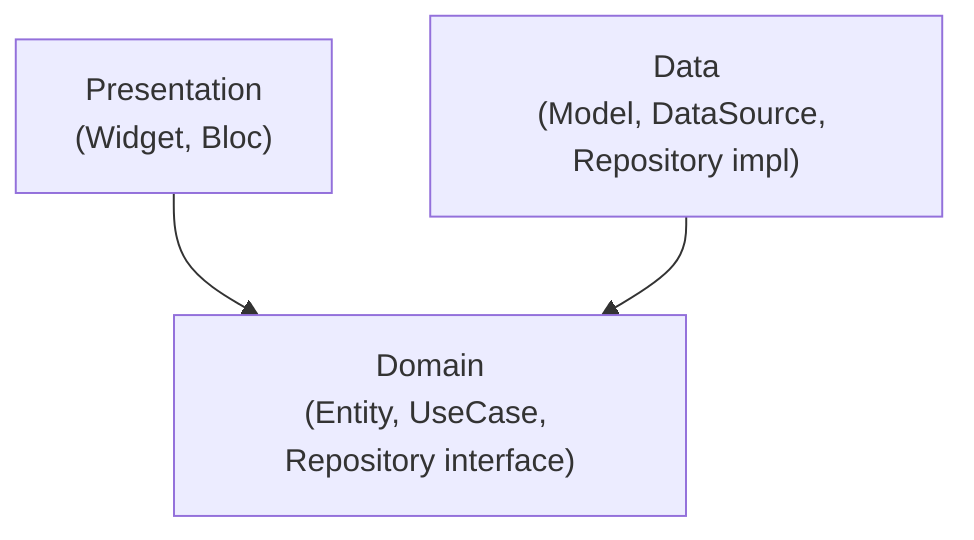
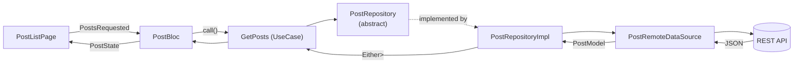

# Clean Architecture Demo — Flutter

Ứng dụng demo **Chủ đề 04: Kiến trúc ứng dụng Flutter — Clean Architecture & Dependency Injection (DI)**.
App đọc danh sách bài viết từ một REST API công khai ([JSONPlaceholder](https://jsonplaceholder.typicode.com/posts)), tổ chức theo 3 tầng **Presentation / Domain / Data**, dùng **get_it + injectable** cho DI và **flutter_bloc** cho quản lý trạng thái.

> Mục tiêu học thuật: chứng minh tầng Domain test được độc lập (mock qua abstract interface) và tầng Presentation **không** phụ thuộc trực tiếp vào Data Source.

---

## 1. Công nghệ

| Mục đích | Thư viện |
|---|---|
| State management | `flutter_bloc`, `equatable` |
| Dependency Injection | `get_it`, `injectable` (+ `injectable_generator`, `build_runner`) |
| HTTP | `dio` |
| Xử lý lỗi dạng giá trị | `dartz` (`Either<Failure, T>`) |
| Biến môi trường | `flutter_dotenv` |
| Test | `flutter_test`, `mocktail` |

## 2. Kiến trúc

### 2.1 Quy tắc phụ thuộc (Dependency Rule)



- **Domain** ở trung tâm, là Dart thuần, không import Flutter/Dio/Data/Presentation.
- **Data** *implement* interface do Domain định nghĩa (**Dependency Inversion Principle**).
- **Presentation** chỉ gọi UseCase của Domain.
- `get_it` + `injectable` nối interface với implementation lúc chạy.

### 2.2 Luồng dữ liệu (Data Flow)



### 2.3 Cấu trúc thư mục

```
lib/
├─ main.dart                      # ensureInitialized -> dotenv -> configureDependencies -> runApp
├─ app.dart                       # MultiBlocProvider (composition root)
├─ core/
│  ├─ di/                         # injection.dart, register_module.dart (+ injection.config.dart do build_runner sinh)
│  └─ error/                      # Failure (Domain) & Exception (Data)
└─ features/post/
   ├─ domain/                     # THUẦN DART
   │  ├─ entities/post.dart
   │  ├─ repositories/post_repository.dart   # abstract
   │  └─ usecases/get_posts.dart
   ├─ data/
   │  ├─ models/post_model.dart
   │  ├─ datasources/post_remote_data_source.dart
   │  └─ repositories/post_repository_impl.dart
   └─ presentation/
      ├─ bloc/ (post_bloc, post_event, post_state)
      └─ pages/post_list_page.dart
test/
├─ features/post/domain/usecases/get_posts_test.dart          # unit test Domain (mock interface)
├─ features/post/data/repositories/post_repository_impl_test.dart
├─ features/post/presentation/post_list_page_test.dart        # UI chạy với Fake repository
└─ architecture/dependency_rule_test.dart                     # kiểm thử kiến trúc (quét import)
tool/check_architecture.sh                                    # kiểm tra nhanh bằng grep
```

## 3. Cài đặt & chạy

### Yêu cầu
- Flutter SDK ≥ 3.19 (Dart ≥ 3.3) — kiểm tra bằng `flutter --version`
- Thiết bị thật (bật USB debugging / Developer Mode) **hoặc** Android Emulator / iOS Simulator
- Kết nối Internet (để gọi API)

### Các bước

```bash
# 1. Clone
git clone https://github.com/AndrasK0712/clean_arch_demo
cd clean_arch_demo

# 2. Tạo thư mục nền tảng (android/ ios/ ...) nếu repo chưa có
#    (không ghi đè lib/ và pubspec.yaml)
flutter create . --project-name clean_arch_demo --platforms=android,ios
#    Nếu lệnh trên sinh ra test/widget_test.dart mặc định thì xóa file đó:
#    rm test/widget_test.dart

# 3. Cấu hình biến môi trường
cp .env.example .env

# 4. Cài package
flutter pub get

# 5. Sinh code DI (injection.config.dart)
dart run build_runner build --delete-conflicting-outputs

# 6. Chạy app
flutter devices
flutter run -d <device_id>
```

> **Android release:** nếu build bản `release`, thêm `<uses-permission android:name="android.permission.INTERNET"/>` vào `android/app/src/main/AndroidManifest.xml` (bản debug đã có sẵn).

### Biến môi trường (`.env`)

| Biến | Mô tả | Mặc định |
|---|---|---|
| `BASE_URL` | Địa chỉ gốc của REST API | `https://jsonplaceholder.typicode.com` |

- `.env` đã nằm trong `.gitignore`; chỉ commit `.env.example`.
- Dự án **không** dùng Firebase nên không cần `google-services.json`. Nếu sau này tích hợp Firebase, đặt file tại `android/app/google-services.json` và **không** commit lên repo công khai nếu chứa thông tin nhạy cảm.

## 4. Kiểm thử

```bash
flutter test                         # chạy toàn bộ
flutter test test/features/post/domain   # chỉ unit test tầng Domain
flutter test test/architecture           # kiểm thử Dependency Rule
sh tool/check_architecture.sh            # kiểm tra nhanh bằng grep
```

| Test | Chứng minh điều gì |
|---|---|
| `get_posts_test.dart` | UseCase test được chỉ với `MockPostRepository` (mock của **abstract interface**), không cần mạng/Dio |
| `post_repository_impl_test.dart` | Data map Model → Entity và Exception → Failure đúng |
| `post_list_page_test.dart` | UI + Bloc chạy được với `FakePostRepository` ⇒ Presentation chỉ cần interface của Domain |
| `dependency_rule_test.dart` | Quét import: Domain & Presentation không import `/data/` hay `dio` |

## 5. Bản chất DI trong dự án

1. `main()` gọi `WidgetsFlutterBinding.ensureInitialized()` → `dotenv.load()` → `configureDependencies()`.
2. `injectable` (qua `build_runner`) đọc các annotation `@injectable`, `@lazySingleton`, `@LazySingleton(as: ...)`, `@module` và sinh `injection.config.dart` đăng ký vào `get_it`:
   - `PostRepository` → `PostRepositoryImpl`
   - `PostRemoteDataSource` → `PostRemoteDataSourceImpl`
   - `Dio` (từ `RegisterModule`, đọc `BASE_URL` từ `.env`)
   - `GetPosts`, `PostBloc`
3. `MultiBlocProvider` trong `app.dart` lấy `PostBloc` từ `getIt` và cấp xuống cây widget. Widget dùng `context.read<PostBloc>()`, không gọi `getIt` trực tiếp.

> Lưu ý thực dụng: UseCase dùng annotation `@lazySingleton` của `injectable` (một package annotation thuần Dart). Nếu muốn Domain hoàn toàn không biết `injectable`, có thể đăng ký UseCase trong một `@module` ở `core/di`.

## 6. Quy ước làm việc nhóm (Git)

- Nhánh: `main` (ổn định) ← `feature/<tên>`; merge bằng Pull Request.
- Commit theo [Conventional Commits](https://www.conventionalcommits.org/): `feat(domain): add GetPosts usecase`, `test(domain): add GetPosts unit tests`, `docs: update README`.
- Mỗi thành viên commit bằng đúng tài khoản/email của mình (`git config user.name`, `git config user.email`).

### Phân công

| Thành viên | MSSV | Nhiệm vụ | Phần code chính |
|---|---|---|---|
| … | … | Khởi tạo dự án, DI, README | `core/`, `main.dart`, `app.dart` |
| … | … | Domain + Data + unit test | `features/post/domain`, `features/post/data`, `test/` |
| … | … | Presentation + slide | `features/post/presentation`, slide |

## 7. Xử lý sự cố

| Triệu chứng | Cách xử lý |
|---|---|
| `Target of URI doesn't exist: injection.config.dart` | Chạy `dart run build_runner build --delete-conflicting-outputs` |
| `Unable to load asset: .env` | Chạy `cp .env.example .env` |
| Xung đột phiên bản package | `flutter pub upgrade --major-versions` rồi build_runner lại |
| Không thấy thiết bị | `flutter doctor -v`, bật USB debugging / mở Emulator |
| Màn hình lỗi mạng | Kiểm tra Internet; emulator Android cần có kết nối mạng |

## 8. Tài liệu tham khảo

- Robert C. Martin — *Clean Architecture*
- [Flutter Architecture Guide](https://docs.flutter.dev/app-architecture)
- [bloc library](https://bloclibrary.dev) · [get_it](https://pub.dev/packages/get_it) · [injectable](https://pub.dev/packages/injectable) · [mocktail](https://pub.dev/packages/mocktail)
